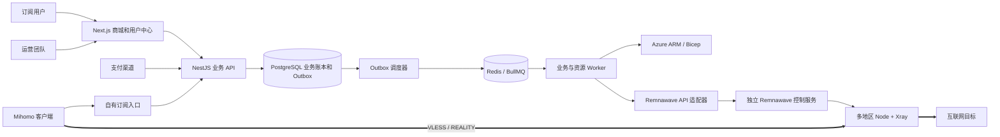

# 系统架构

状态：推荐设计，尚未实现。

## 总体结构

客户端流量直接到地区节点。订阅入口、支付回调和网页使用普通 HTTPS；REALITY 的入站直接监听节点 TCP 443，不通过网页的 HTTP 反向代理。地区分组由订阅配置体现，不假设在所有 VM 前面放一个全球负载均衡器就能保留地区选择。

## 技术选型

| 模块 | 选择与原因 | 可替换边界 |
| --- | --- | --- |
| 网页 | Next.js + TypeScript，商城、账户与管理员页面共用组件 | 只调用业务 API，不带云或面板管理密钥 |
| API | NestJS 模块化单体，权限、依赖边界和 OpenAPI 易维护 | 按身份、商品、交易、权益、云、节点、审计划分模块 |
| 数据 | PostgreSQL，交易、唯一约束、行锁和 outbox；Prisma 管理映射与迁移 | 关键约束必须落数据库，不能只靠 ORM |
| 队列 | BullMQ + Redis，异步部署、回调处理、周期对账 | 任务可重入，业务真相保留在 PostgreSQL |
| 节点管理 | Remnawave 独立进程与独立数据库 | 仅 engine adapter 可以访问其 API；不读写上游数据库 |
| 云操作 | Azure SDK 执行授权与资源操作，Bicep 固化资源定义 | 云供应商适配器屏蔽 ARM 操作和长任务轮询 |
| 支付 | Stripe 托管结账、周期账单与用户门户 | PaymentProvider 负责验签、标准事件和查询对账 |
| 身份 | 成熟 OIDC 提供方，管理员强制 MFA，服务端会话 | 应用自己维护 staff 权限与 customer 归属 |
| 观测 | OpenTelemetry、结构化日志、健康探测 | 日志不含订阅 token、接入 UUID、私钥或支付敏感内容 |

框架依据可查 [Next.js](https://nextjs.org/docs)、[NestJS OpenAPI](https://docs.nestjs.com/openapi/introduction)、[Prisma 事务](https://www.prisma.io/docs/orm/fundamentals/transactions)、[BullMQ 幂等任务](https://docs.bullmq.io/patterns/idempotent-jobs)。具体版本在实现阶段锁定，本次不生成未经安装验证的 lockfile。

## 数据所有权

xRay-zoo 拥有商品、订单、支付记录、已购周期、权益、客户与管理权限。Remnawave 拥有节点运行状态和引擎侧用户配置。引擎侧 user ID 只是映射，不能作为公开客户 ID 或支付主键。

业务数据库提交权益快照并同时写 outbox，worker 按版本同步引擎。上游 API 返回成功后读回核对，记录 `desired_version` 与 `applied_version`。同步滞后只影响交付状态，不倒退已确认的支付事实。

每个客户权益同步串行；旧任务执行前重读最新版本。数据库事务不跨网络调用。远端成功、写本地结果前崩溃时，用稳定映射和查询回读恢复，不能盲目再次创建用户。每 5 分钟做增量对账，每日全量检查漂移，这是初始目标值。

## 引擎适配边界

- 节点池映射到引擎分组，套餐允许范围先在业务服务校验。
- 用户创建使用稳定业务引用；引擎 username 使用内部 ID 派生值，不发送客户邮箱。
- 额度和到期由 xRay-zoo 确定，通过 adapter 写入上游；上游独立自动重置策略关闭，避免两个时钟重置同一额度。
- 订阅模板由 xRay-zoo 持有，原始接入数据经 adapter 取回并渲染；上游订阅入口不公开转发，避免绕过本平台停用检查。
- 以 `capabilities` 暴露经验证的能力，例如流量全局聚合、立即踢连接和轮换身份；不能从 API 名字推定语义。
- 计量只由一个组件负责采集上游核心计数，防止多个消费者使用 reset 型统计接口互相清零。

## 首次运行拓扑

内测将 web、api、worker、Redis、业务 PostgreSQL、Remnawave 与其独立数据库部署在一台专用控制服务器，采用 Docker Compose 和反向代理。两套数据库可用同一 PostgreSQL 实例的独立 database / role，禁止跨库直接读写。先按 4 vCPU / 8 GiB 预算压测，不宣称高可用。

地区节点独立 VM，每台仅承载 Node、Xray 与最小观测进程。建议验证 1 GiB 与 2 GiB 两档，并测 CPU credits 耗尽后的吞吐和内存，而不是只测开机空载。

开始正式收费前，业务数据库迁往有备份与恢复能力的独立/托管实例，并完成恢复演练。控制服务可随后迁往 Azure Container Apps；常驻 worker 和面板不能按“无人访问时全部缩零”的假设运行。节点继续使用 VM，不把长连接网络业务塞进 HTTP 函数。

## 故障语义

| 故障 | 对外表现 | 恢复方式 |
| --- | --- | --- |
| 支付成功，引擎暂时不可达 | 已付款、开通中，保留已购周期 | 幂等重试，对账，超过交付期限进入补偿流程 |
| 控制面失联 | 已连接数据面可能继续运行，暂停新开通 | 展示真实未知状态，恢复后先对账再恢复销售 |
| 节点失联 | 新订阅暂不加入该节点，缓存配置仍可能尝试连接 | 健康恢复后按版本同步；替换节点不重建用户订单 |
| Redis 丢任务 | 业务事实和 outbox 仍保留 | 重放未完成 operation，不能靠 job ID 作为唯一去重凭据 |
| 凭证过期 / ARM 配额不足 | 云任务失败，现有节点继续按当前状态运行 | 更新云连接或缩小部署，按资源清单重试 |
| 撤销期间节点不可达 | 显示部分撤销，不能声称所有接入已禁用 | 重试、告警；必要时隔离该节点或停止发布 |

失联时“还能用”和“额度受控”必须通过实际测试分别评估。未实现并验证本地租约或限额执行前，不承诺控制面离线时能精确到期停用。生产限制见交付计划。
