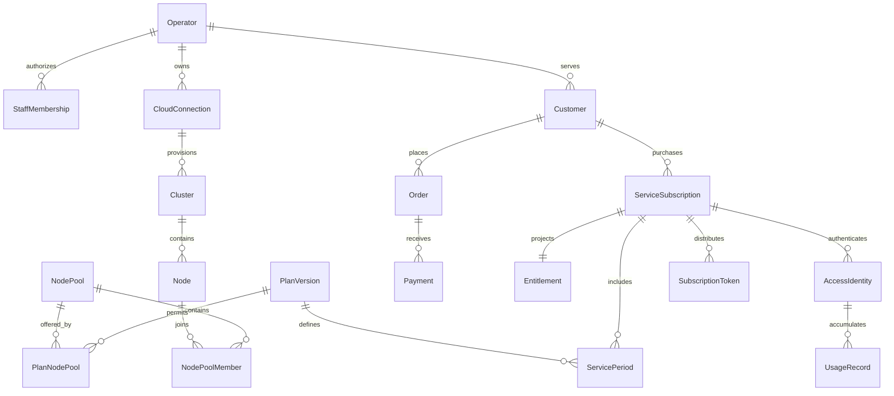

# 数据模型与 RBAC

状态：逻辑设计，尚未生成数据库迁移。

## 主要关系

## 表与关键约束

| 表 | 核心字段 | 约束与用途 |
| --- | --- | --- |
| operators | id, name, currency, timezone | 首版一条记录；计量存 UTC，展示时区单独处理 |
| identities | id, issuer, subject | `(issuer, subject)` 唯一；关联外部身份提供方 |
| staff_memberships | operator_id, identity_id, role | 管理身份与订阅身份分开授权 |
| customers | operator_id, identity_id, email_verified_at | 邮箱改变不改变客户主键 |
| cloud_connections | operator_id, tenant_id, client_id, subscription_id, auth_kind, secret_ref, allowed_scopes, expires_at | 凭证密文或引用，不保存可回显明文 |
| clusters | connection_id, blueprint_version, desired_revision, state | 一个集群同一时刻一个变更操作 |
| nodes | cluster_id, region, azure_resource_id, engine_node_id, state, desired_revision, applied_revision | ARM resource ID 唯一；保留删除墓碑 |
| node_pools / node_pool_members | operator_id, name / node_id | 显式多对多；删除节点先移出可售池 |
| plan_versions | operator_id, plan_key, version, amount_minor, currency, interval, quota_bytes, published_at | 发布后不可原地改价/额度；价格为货币最小单位整数 |
| plan_node_pools | plan_version_id, node_pool_id | 套餐地区权限必须是显式映射 |
| orders | customer_id, kind, plan_version_id, status, amount_minor, currency, checkout_id | 服务端冻结价格，provider checkout ID 唯一 |
| payments / refunds | provider_account_id, external_id, order_id, amount_minor, currency, status | 外部资金 ID 唯一；退款金额累计不可超过可退余额 |
| service_subscriptions | customer_id, provider_subscription_id, state, cancel_at_period_end | 首版每客户一个非终止订阅，用部分唯一索引约束 |
| service_periods | subscription_id, order_id, invoice_id, start_at, end_at, plan_version_id, quota_bytes, status | 渠道账户 + invoice ID 唯一；有效期为 `[start,end)` |
| entitlements | subscription_id, version, status, valid_until, quota_remaining, pool_set_hash | 投影结果，与账单状态独立；版本单调增长 |
| access_identities | subscription_id, engine_user_id, credential_ref, credential_version, state | 接入凭证可加密取回；每代凭证单独跟踪 |
| subscription_tokens | subscription_id, token_hash, token_ciphertext, key_version, revoked_at | 查验用 hash；加密副本仅供本人再次复制链接，客服无权读取 |
| usage_records | identity_id, source_id, counter_epoch, sample_id, up_bytes, down_bytes, observed_at | 来源幂等键唯一，非负整数；金额账本不与流量混用 |
| usage_period_totals | period_id, billable_bytes, last_sample_at, completeness | 缺样本明确标为 incomplete，不假装用量为零 |
| provider_events | provider_account_id, event_id, type, received_at, payload_ref, status | `(provider_account_id,event_id)` 唯一，验签后持久化 |
| operations / operation_steps | kind, resource_id, idempotency_key, desired_revision, state, lease_until | 重试和恢复可追踪；保留 ARM operation URL 的受控引用 |
| outbox_events | aggregate_id, version, event_type, payload, delivered_at | 与业务事实同事务写入；投递允许重复 |
| audit_events | actor, permission, resource_id, result, request_id, occurred_at | 追加记录；敏感字段脱敏，不记录完整订阅链接 |

每张业务表带 `operator_id`，关联必须校验一致性。首版使用服务端仓储范围检查与数据库复合约束；没有通过隔离测试前不宣称具备多租户安全能力。普通用户请求的 customer ID 从会话解析，不能信任 body 中传入的归属。

## 角色矩阵

“本人”仅限 customer 自己。`Owner` 是本应用经营者角色，不等同 Azure Owner。

| 操作 | Owner | Admin | Operator | Finance | Support | Customer |
| --- | --- | --- | --- | --- | --- | --- |
| 管理成员角色 | ✓ | 仅非 Owner | — | — | — | — |
| 创建/轮换云凭证、支付凭证 | ✓ | — | — | — | — | — |
| 查看云连接状态 | ✓ | ✓ | ✓ | — | — | — |
| 创建/扩容节点，在已授权预算内 | ✓ | ✓ | ✓ | — | — | — |
| 摘流/重启节点 | ✓ | ✓ | ✓ | — | — | — |
| 永久删除节点资源 | ✓ | ✓ | — | — | — | — |
| 发布套餐、调价格 | ✓ | ✓ | — | — | — | — |
| 查看用户服务状态/脱敏用量 | ✓ | ✓ | ✓ | ✓ | ✓ | 本人 |
| 手工停用/恢复权益，记录原因 | ✓ | ✓ | — | — | — | — |
| 发起退款 | ✓ | — | — | ✓ | — | 仅申请 |
| 查看收入与渠道对账 | ✓ | — | — | ✓ | — | 本人账单 |
| 查看云成本 | ✓ | ✓ | ✓ | ✓ | — | — |
| 复制/重置用户订阅 token | — | — | — | — | — | 本人 |
| 重置本人接入身份 | — | — | — | — | — | 本人 |
| 查看审计记录 | ✓ | 按管理范围 | 自己操作 | 财务范围 | 自己操作 | — |

角色是 permission 集合，服务端做 deny-by-default。节点权限还受 cluster scope、region allowlist、规格/数量预算上限约束。Owner 可以暂停客户和强制撤销身份，但不能悄悄导出客户的活动接入秘密；故障协助使用用户主动的重置流程。

## 身份与操作保护

管理员 OIDC + MFA；订阅用户邮箱验证后购买。会话使用 HttpOnly、Secure cookie，并保护基于 cookie 的写操作免受 CSRF。后台 API 不因前端隐藏按钮而省略鉴权。

凭证更新只写入，保存后显示指纹、到期和使用状态。证书含私钥的文件进入秘密存储，上传临时文件用后清理。正常 API 响应不返回密钥，备份加密钥匙不与数据库备份置于同一权限域。

订阅 token 是 bearer 凭证，至少 32 随机字节。路由、反向代理、错误采集、分析 SDK 都不能记录原始 token。用户页不加载会外发 referrer 的第三方追踪资源。接入凭证和 token 独立轮换，撤销状态不会被旧任务覆盖。

## 一致性场景

- 同时点击两次付款，复用同一 checkout 意图；两个真实付款则保留两笔资金记录并进入处理队列，不能静默丢账。
- 重复 invoice.paid 命中唯一约束，只产生一个服务周期。
- 管理员修改套餐后，历史订单仍指向原版本。
- 客户升级为 Staff，不自动得到其他客户订阅 token 的读取权。
- 删除 Azure 节点不删除支付和用量历史；资源清理只针对有所有权记录的 ARM ID。
