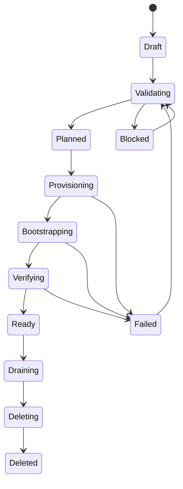

# Azure 接入与集群编排

状态：五区 P0 节点已实际部署；2026-11-18 新增本地管理员“上机器”流程。当前实现及验证边界见 [后台上机器运行手册](14-machine-provisioning.md)。下文包含后续生产架构设计，不代表所有目标能力已实现。

## 管理员需要提供什么

Azure 资源管理使用 Entra 身份，不存在一把可通用创建 VM 的 Azure API Key。Azure OpenAI 的 key 也不能创建机器。

| 认证方式                          | 所需内容                                                         | 首版定位                                    |
| --------------------------------- | ---------------------------------------------------------------- | ------------------------------------------- |
| Service Principal + client secret | tenant ID、client ID、subscription ID、client secret、授权资源组 | 便于首次连接，支持到期提醒与轮换            |
| Service Principal + certificate   | 前三项、含私钥的 PEM/PFX、必要的口令；公钥证书已登记到应用       | 同等支持；只有 `.cer` 公钥不能代表应用签名  |
| Managed Identity                  | 控制服务的托管身份及对目标资源组的授权                           | 同租户 Azure 部署优先采用，后续简化凭证管理 |
| Workload Identity Federation      | 可信签发方、subject、audience                                    | 用于后续 CI/跨环境部署，首版不做通用配置 UI |

凭证存在 Key Vault 或有主密钥保护的 SecretStore，数据库只存引用与指纹。Worker 读取云凭证，用户网页和地区节点拿不到这些凭证。[服务主体与认证方式](https://learn.microsoft.com/en-us/entra/identity-platform/howto-create-service-principal-portal)

## 授权范围

建议先在 Azure 准备专用资源组 `xray-zoo-prod`，与现有模型资源组分开。资源组可容纳不同区域的 VM，但每个区域的 VNet、NIC 与 VM 必须按 Azure 区域约束组合。

- **一次性准备者**：创建资源组、注册 Compute / Network 等资源提供程序，给连接身份授权。平台日常 worker 不持有角色分配权限。
- **资源创建身份**：首版可在专用资源组授予 Contributor，便于 Bicep 部署 VM、磁盘、NIC、NSG、Public IP、VNet。它在该资源组内权限较宽，界面必须写清范围。后续按实际调用收敛为自定义角色。
- **订阅元数据**：地区、SKU、配额检查可能需要订阅级读取权限；单独列出检查项，权限缺失时不能显示全部可用。
- **成本读取**：Cost Management Reader 或等效读取权限，作用域与查询账单一致。预算管理另行授权，不悄悄扩大资源创建身份的权限。
- **秘密读取**：控制服务的 Key Vault 数据面授权单独授予；节点只获得自己的初始化材料。

Contributor 不能分配 Azure RBAC 角色；Bicep 不得默认创建角色分配。仅 Virtual Machine Contributor 不足以承担所有网络资源创建。[Contributor 定义](https://learn.microsoft.com/en-us/azure/role-based-access-control/built-in-roles/privileged) · [成本等管理角色](https://learn.microsoft.com/en-us/azure/role-based-access-control/built-in-roles/management-and-governance)

## 资源蓝图

一个地区创建 VNet / Subnet / NSG；每台节点创建 Linux VM、OS disk、NIC、Standard Static IPv4。优先 Ubuntu LTS 或 Debian 的经过确认的 cloud-init 镜像，固定实际镜像版本。每个资源带 operator / cluster / node / operation / managed-by 标签，并在数据库保存真实 ARM ID。

初始只开放客户端 TCP 443。节点管理端口只允许控制服务器固定来源地址，且使用上游认证与 TLS；具体端口和证书在锁定的 Node 版本上核对。SSH 默认不向公网开放，维护通道另行受限启用。IPv6 不自动启用；启用时必须同步 NSG、主机防火墙与出站限制。

REALITY 不使用普通 HTTP 反向代理终止连接。网页证书、云服务主体证书、REALITY 私钥和 Node 管理证书是四种不同用途的材料，不能混用。配置导出只给客户所需公钥与接入身份。

代理进程出站应拒绝本机、私网、链路本地和 Azure IMDS 管理地址，并覆盖 IPv6。用于节点初始化的系统进程需要的元数据访问与代理业务进程分开限制，防止代理用户触及机器身份或管理服务。若配置允许域名目标，解析后的地址也要受同等策略约束。

## 预检与部署

集群包含地区和节点子任务，各自有状态；任一失败时集群可为 `partial`。Ready 要求 ARM 资源完成、引擎注册完成、配置版本一致且合成客户端连通测试通过。

1. 验证身份、凭证到期、允许作用域和请求参数。
2. 查询地区 SKU restrictions、regional vCPU / family quota、公共 IP 配额与镜像可用性。预检通过仍不保证执行时容量，保存失败原因并允许换地区/规格。
3. 生成版本化蓝图、资源清单、费用估算；Bicep what-if 提供差异，不替代价格计算或配额验证。what-if 也需要相应部署权限。[官方说明](https://learn.microsoft.com/en-us/azure/azure-resource-manager/bicep/deploy-what-if)
4. 用户提交具体 plan ID 和 revision 后，保存 operation 及 outbox。任务绑定计划哈希，计划内容改变或过期则重新预览。
5. Worker 以 deterministic resource names 执行增量 ARM deployment，保存长任务状态；遵守 Retry-After，指数退避并限制每订阅并发。
6. cloud-init 只安装锁定版本引导组件并写入非秘密节点 ID / 控制地址；记录检查和健康事件。
7. 独立初始化身份验证后获取该节点的管理材料，启动上游 Node，注册配置，执行探测，加入候选节点池。
8. 发布动作把已验证节点加入可售池；导出蓝图及操作摘要。

cloud-init 在首次启动执行；Azure 的 VM provision 成功不等同应用安装完成。不得把长期 secret、节点管理密钥或 REALITY 私钥放进 custom data。[cloud-init](https://learn.microsoft.com/en-us/azure/virtual-machines/linux/using-cloud-init) · [custom data](https://learn.microsoft.com/en-us/azure/virtual-machines/custom-data)

## 无长期秘密的初始化方案

拟采用节点 system-assigned managed identity 认证初始化接口。创建 VM 后 worker 从 ARM 读回 principal ID，并把它绑定到预期 node ID。节点从 IMDS 取得面向平台 API audience 的令牌；控制面校验签发租户、audience、签名、有效期、principal ID 与待初始化节点的绑定，不能只信任客户端上报的 VM ID。

通过验证后提供一次性的节点初始化响应，只含该节点材料；不返回 Azure 管理身份或面板全局 API token。节点身份不授予 Azure 管理角色。此流程需要专用 API 应用注册、实际 Azure 令牌验证和上游 Node 初始化适配，是 P0 必测项；本次不声称已实现。备选是受保护的扩展设置递送短期单次令牌，须记录暴露面和失效时间，不使用普通 custom data 存长期密钥。[VM 托管身份令牌](https://learn.microsoft.com/en-us/entra/identity/managed-identities-azure-resources/how-to-use-vm-token) · [IMDS](https://learn.microsoft.com/en-us/azure/virtual-machines/instance-metadata-service)

## 恢复、替换与清理

- 创建超时先查询同名 ARM 资源和 deployment，不能直接换名字重建。
- 保存资源 ownership inventory。失败清理只针对当前操作创建且未共享的资源，保留未清理清单和账单风险。
- 重试不会销毁健康节点。更新先创建替代节点，验证后发布，再摘流旧节点；现有 TCP 连接不能无损迁移。
- 删除先停用新分配、摘流、撤销节点凭证，再按依赖顺序清理 VM、NIC、Public IP、磁盘。VNet 等共享资源只有无引用时才删除。
- 每日核对标签和 inventory，识别遗留磁盘/IP。不能将取消任务等同资源自动回滚。
- 成本上限用于阻止新增/扩容；Azure 预算告警和成本数据有延迟，不能当成实时硬停机。运行中限额靠节点侧计量和产品策略。

初始 VM 候选 B2ats_v2 用于验证，生产按持续吞吐选择。B 系列是 CPU credit 模型，信用耗尽会限速，不能凭标称 vCPU 和带宽保证持续代理性能。[Basv2 规格](https://learn.microsoft.com/en-us/azure/virtual-machines/sizes/general-purpose/basv2-series)
