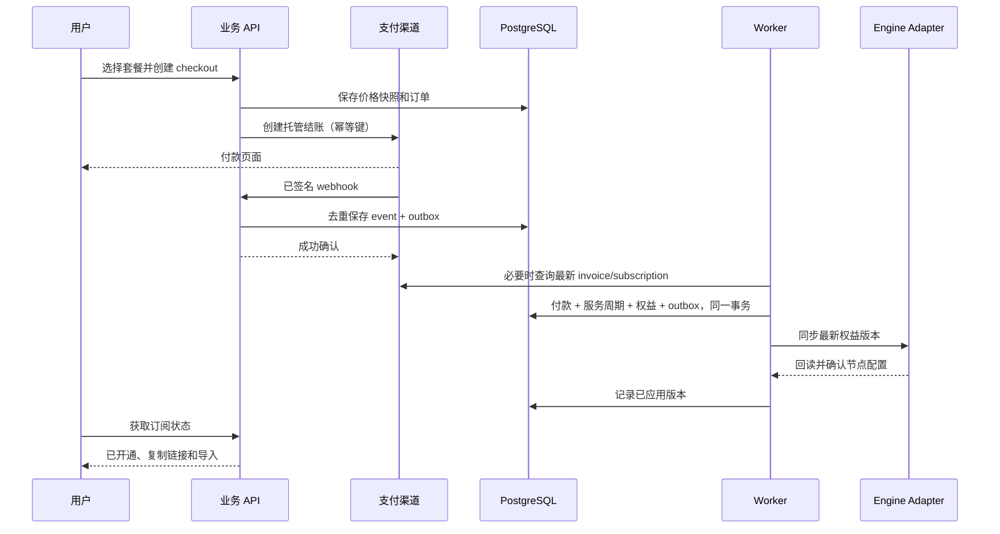

# 支付、额度与订阅交付

状态：业务与一致性设计，未接入真实支付。

## 首版商品规则

月付、单币种、无免费试用、无余额钱包。一位用户一个当前服务订阅，套餐是不可变版本。首版优先采用 Stripe Checkout + Billing + Customer Portal；是否可以收取目标币种和支持特定支付方式，取决于实际商户账户。支付提供方接口保留其他渠道扩展，不把“支付宝可一次性支付”推定为“可自动周期扣款”。

结账成功页只展示进度。服务端根据渠道已验证账单与付款状态生成服务周期，再把权益同步到节点。用户自助更新支付方式和取消续费走托管门户。[Stripe 订阅事件](https://docs.stripe.com/billing/subscriptions/webhooks) · [Customer Portal](https://docs.stripe.com/customer-management)

## 状态分离

| 对象 | 状态 |
| --- | --- |
| Order | pending → paid / expired / canceled，退款为独立记录和汇总状态 |
| Payment | pending / succeeded / failed / partially_refunded / refunded / disputed |
| Service Subscription | pending / active / past_due / suspended / ended |
| Entitlement | pending / enabled / exhausted / expired / suspended |
| Engine delivery | pending / applying / applied / degraded / failed |

付款成功不能被节点创建失败改成付款失败。页面需要同时显示资金状态与交付状态。客户端已有配置时，禁止获取新配置本身不足以阻止联网，必须在节点侧停用接入身份。

## 付款与开通时序

收到事件先验证签名与原始 body，限制 payload 大小；持久化成功才回应 2xx。事件按渠道账户与 event ID 去重，但还要对 invoice / charge / refund 做业务唯一约束，处理“不同事件描述同一资金事实”。同一订阅串行化处理，必要时查询渠道最新对象，不能按到达顺序盲改状态。[Webhook 文档](https://docs.stripe.com/webhooks)

## 事件处理规则

| 事件/情景 | 业务处理 |
| --- | --- |
| checkout.session.completed | 关联订单与渠道 customer/subscription；不单凭该事件发放权益 |
| invoice.paid | 校验属于本商户、本客户、预期价格/币种，invoice 已支付且账期明确；按唯一 invoice 创建或确认服务周期 |
| invoice.payment_failed | 标记续费问题并通知；不提前取消仍有效的已购周期 |
| customer.subscription.updated | 更新取消续费安排和渠道状态；最终权益由已购周期、暂停和额度综合得出 |
| customer.subscription.deleted | 停止未来自动续期，按真实终止时间与已购周期重算；不凭迟到事件撤销后来新订阅 |
| 全额退款 | 只撤销与退款对应的服务周期权益；当前在用周期全退则停用，历史期退款不盲删现在权益 |
| 部分退款 | 保存退款账，不自动按金额推断有效期；由明确业务动作决定服务变更 |
| 支付争议 | 标记风险与争议账，按预设策略暂停当前服务并保留证据/审计，解决后重算权益 |
| 付款成功但没有可用节点 | 保持 paid、交付失败可见；重试，达到配置的交付期限后由 Finance/Owner 执行补偿或退款 |

初次 invoice 关联 checkout 对应订单；续费 invoice 以其唯一 ID 创建 renewal order 并冻结套餐版本，资金记录与服务周期因此均有订单归属。

首版不提供任意零元套餐；金额为零的已付账单只有与允许的价格/折扣规则一致才能发权。付款金额、客户 ID、有效期不能从浏览器 success URL 或 metadata 单独采信。

## 周期、续费与流量

- 服务周期使用渠道确认的账期 `[start_at,end_at)`，以 UTC 保存；不能用 webhook 到达时间加 30 天，也不能每收到一次事件延长一次。
- 已付款的下一周期提前到达时先保存 pending period，时间到达后切换；周期任务遗漏可通过每次读取重算恢复。
- 月底、闰年和时区由渠道账期决定。首版套餐变更从下一周期生效，不引入即时 prorate。
- 所有节点合计上传 + 下载，GB = 10^9 bytes；可售额度不得按“每个节点都有一份完整额度”重复授予。
- 引擎累计值不能当日增量反复累加。adapter 输出带稳定来源、计数 epoch、采样 ID 的记录；同一 epoch 用差值，重启/重置开新 epoch，低于上一值不能简单当负数抵扣。
- 首版选择引擎聚合用户统计作为唯一计量源，xRay-zoo 保存快照和周期账；按节点细分只有 adapter 证明来源不重复才加入。
- 周期切换使用持久化 meter baseline，不依赖可重复执行的“reset 总量”命令。若引擎只接受“自上次重置的总限额”，adapter 转为 `当前累计值 + 本周期剩余额度`，按版本覆盖、回读确认；必要重置必须先做 final sample 并记录新 epoch。
- 跨周期采样没有准确时段时，记录不确定区间并采用明确、对用户有利的归属规则；不能把估算伪装成精确账单。
- 到达额度或有效期后进入高优先级停用队列；正常网络目标 60 秒内执行，失联节点仍是未完成撤销。

采样频率建议 15–30 秒，入账目标 60 秒内，具体依据上游 API 负载调整。多节点并发和传播时延必然存在额度超用窗口。粗略上界为各节点速率之和 × 采样及执行时延，若未实际实施速率限制，就不存在可信的固定超用上界。

## 订阅链接与客户端配置

公开 URL 形状为 `https://sub.example.com/s/<opaque-token>/mihomo.yaml`。token 与引擎原生订阅 ID 分离；服务端检查状态、有效期、额度、已同步版本和节点健康后渲染。响应使用 `Cache-Control: private, no-store`，订阅路径排除 CDN 缓存，设置 `Referrer-Policy: no-referrer`，反向代理日志脱敏。

首版输出完整 Mihomo YAML，明确 VLESS + TCP + REALITY + Vision；地区节点按套餐过滤，自动选择与手工地区选择并存。健康检测有抖动抑制，不能因为一秒失联就不断改配置。可返回 `subscription-userinfo` 的 upload / download / total / expire，需用目标客户端验证解释与单位。

到期或停用时不返回有效代理凭证，给出稳定 403/410 错误和用户中心提示；客户端可能保留旧配置，因此节点停用必须独立完成。所有地区暂时不可用返回 503，不降级到未获授权节点，不偷偷返回可绕过业务检查的上游 URL。

用户中心再次复制链接需要解密受控 token 副本；查验只用 hash。重置链接立即废止旧 token，但不改变已缓存的节点 UUID。选择“疑似泄露，重置接入身份”时，同时轮换接入身份、重新下发节点配置，并显示仍未同步的节点。仅删除用户数据库行不会完成这一动作。

## 对账与停用

支付 webhook、业务账本、引擎状态三方对账。每日检查已付未交付、活跃但无有效周期、退款后仍启用、引擎用户无业务归属等异常，保留修复操作与原因。

面板失联时上游节点是否本地执行到期、如何处理已建立连接，必须作为 P0 实验。若无法保证，应将失联节点移出销售范围，限制其客户规模和风险预算；达到规定失联期限可由独立健康监督任务隔离该节点并停止 Xray，会影响该节点所有用户。不能承诺“没有控制面也能严格执行每用户额度”。

首版不售卖依赖严格设备数或永久无限流量的套餐。一般 Clash/Mihomo 的 UA、IP、HWID 不足以证明一台真实设备。
